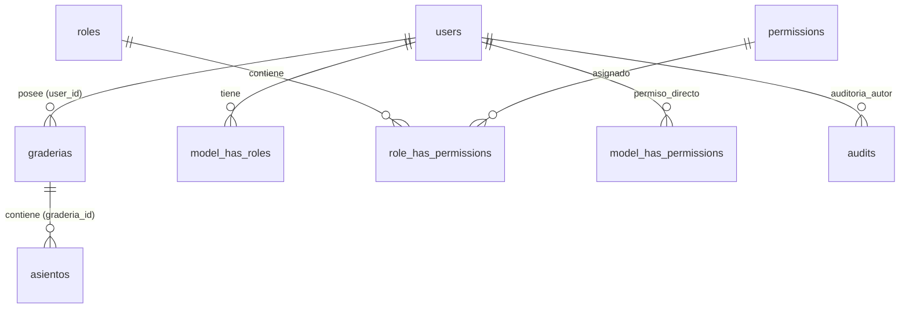

# 🏟️ Sistema de Gestión y Venta de Graderías (Eventos y Espectáculos)

Sistema completo para el diseño geométrico matricial, reserva, venta e impresión de boletos para graderías y butacas de eventos masivos (Carnaval de Oruro, festivales, conciertos, eventos deportivos).

Desarrollado bajo una arquitectura desacoplada:
- **Backend:** Laravel 12.x (API RESTful, Sanctum, Owen-It Auditing, Spatie Permissions).
- **Frontend:** Quasar Framework v2 (Vue 3, Vite, Pinia, jsPDF, Printd).
- **Base de Datos:** MySQL / MariaDB (InnoDB).

---

## 📑 Tabla de Contenidos
1. [Estructura del Proyecto](#-estructura-del-proyecto)
2. [Base de Datos: Tablas y Relaciones](#-base-de-datos-tablas-y-relaciones)
3. [Colas (Queues) y Tareas en Segundo Plano](#-colas-queues-y-tareas-en-segundo-plano)
4. [Seeders del Sistema](#-seeders-del-sistema)
5. [Roles y Permisos](#-roles-y-permisos)
6. [Flujo de Negocio Paso a Paso](#-flujo-de-negocio-paso-a-paso)
7. [Concurrencia, Transacciones y Doble Venta de Asientos](#-concurrencia-transacciones-y-doble-venta-de-asientos)
8. [Auditoría y Rollbacks](#-auditoría-y-rollbacks)
9. [Vulnerabilidades y Deuda Técnica Detectada](#-vulnerabilidades-y-deuda-técnica-detectada)
10. [Hoja de Ruta para la Versión 2.0](#-hoja-de-ruta-para-la-versión-20)
11. [Guía de Instalación y Ejecución](#-guía-de-instalación-y-ejecución)
12. [Documentación Extendida](#-documentación-extendida)

---

## 📂 Estructura del Proyecto

```text
graderias/
├── back/                       # Backend (Laravel 12)
│   ├── app/
│   │   ├── Http/Controllers/   # AsientoController, GraderiaController, UserController, WhatsAppController
│   │   ├── Mail/               # TicketPaidMail (Plantilla de correo con PDF adjunto)
│   │   ├── Models/             # User, Graderia, Asiento
│   │   ├── Policies/           # GraderiaPolicy (control de propiedad)
│   │   └── Services/           # AsientoGenerator (algoritmo matricial de asientos)
│   ├── database/
│   │   ├── migrations/         # Migraciones de base de datos
│   │   └── seeders/            # DatabaseSeeder, EventoSeeder (legacy)
│   └── routes/
│       └── api.php             # Definición de endpoints REST y middlewares
├── front/                      # Frontend (Quasar Framework v2 / Vue 3)
│   ├── src/
│   │   ├── addons/             # Imprimir.js (recibos térmicos), Alert.js, Excel.js
│   │   ├── boot/               # axios.js (interceptor de token Sanctum)
│   │   ├── layouts/            # MainLayout, PublicLayout, Login
│   │   ├── pages/              # Graderias, Asientos, Venta, Usuarios, Perfil
│   │   └── stores/             # Pinia Store (estado de autenticación)
├── detalle_sistema.md          # Documento maestro técnico detallado
└── README.md                   # Guía de arquitectura y operaciones
```

---

## 🗄️ Base de Datos: Tablas y Relaciones

El esquema de base de datos se centra en la relación entre el **Usuario**, la **Gradería** y los **Asientos** generados automáticamente:



### 1. `users` (Usuarios y Operadores)
- **Campos principales:** `id`, `name`, `username`, `email`, `password` (hash Bcrypt), `clave` (⚠️ texto plano), `telefono_contacto_1`, `telefono_contacto_2`, `avatar`, `role`.
- **Propósito:** Credenciales de acceso a la consola de administración y teléfonos de contacto expuestos en la vista pública.

### 2. `graderias` (Estructura y Dimensiones de Tribunas)
- **Campos principales:** `id`, `user_id` (dueño), `nombre`, `codigo`, `code` (token alfanumérico público único para compartir por enlace), `direccion`, referencias (`ref_izquierda`, `ref_derecha`, `ref_frente`), `filas`, `columnas`, `capacidad_total`, `etiqueta_modo` (`fila` o `columna`), `start_top` (booleano), `start_left` (booleano), `activo`.
- **Propósito:** Define las dimensiones geométricas y reglas de nomenclatura para el renderizado del mapa de asientos.

### 3. `asientos` (Butacas Individuales)
- **Campos principales:** `id`, `graderia_id`, `fila`, `columna`, `codigo` (ej: "A1", "B12"), `descripcion`, `estado` (`LIBRE`, `RESERVADO`, `PAGADO`, `BLOQUEADO`), `cliente_nombre`, `cliente_celular`, `monto`, `reservado_at`, `pagado_at`.
- **Restricción de unicidad:** `UNIQUE(graderia_id, codigo)`. No pueden existir dos asientos con el mismo código en una misma gradería.

### 4. Tablas del Ecosistema de Seguridad y Auditoría
- `roles`, `permissions`, `model_has_roles`, `model_has_permissions`, `role_has_permissions` (Spatie Permission v6).
- `audits` (Owen-It Auditing): Registra cada cambio (INSERT, UPDATE, DELETE) en usuarios, graderías y asientos con valores anteriores y posteriores.

---

## ⚡ Colas (Queues) y Tareas en Segundo Plano

- **Driver configurado:** `QUEUE_CONNECTION=database` en el archivo `.env`.
- **Tablas migradas:** `jobs`, `job_batches`, `failed_jobs`.
- **Script en composer:** `php artisan queue:listen --tries=1`.
- **Situación actual:** Existe la clase de correo encolable `TicketPaidMail`, pero **no se encuentra encolada activamente en los controladores**. Las ventas, generación de asientos y WhatsApp se procesan de forma síncrona en el ciclo HTTP.

---

## 🌱 Seeders del Sistema

1. **`DatabaseSeeder.php`**:
   - Genera el usuario administrador por defecto:
     - **Usuario:** `admin`
     - **Contraseña:** `admin123Admin`
     - **Rol:** `Administrador`
   - Inicializa los permisos: `Dashboard`, `Usuarios`, `Graderias`.
   - Asigna todos los permisos al usuario admin.
2. **`EventoSeeder.php` / `EventoHorarioSeeder.php`**:
   - Archivos heredados de un sistema turístico previo (Egipto). Están comentados en `DatabaseSeeder` y deben depurarse en la Versión 2.0.

---

## 👥 Roles y Permisos

El sistema utiliza un esquema híbrido:

| Permiso | Módulos Permitidos | Funcionalidad en el Sistema |
|---|---|---|
| **Dashboard** | Inicio (`/`) | Visualización de estadísticas generales de ocupación. |
| **Usuarios** | `/usuarios`, `/users/*` | Crear operadores, cambiar contraseñas de otros usuarios, asignar permisos y avatares. |
| **Graderias** | `/mis-graderias/*` | Diseñar graderías, generar butacas, consola de venta, reservas y reportes de impresión. |

> **Nota de Seguridad:** Las políticas actuales verifican estrictamente `graderia.user_id === user.id`. Por ende, un usuario con rol `Administrador` actualmente **no puede ver ni editar graderías de otros usuarios**. En la Versión 2.0 se debe habilitar el acceso global para administradores.

---

## 🔄 Flujo de Negocio Paso a Paso

1. **Creación de Gradería:** El usuario ingresa a `/mis-graderias/nueva`, define nombre, filas (ej. 10), columnas (ej. 20) y orientación.
2. **Generación Matricial (`AsientoGenerator`):** El backend ejecuta un algoritmo de conversión numérica a letras de alfabeto (1=A, 2=B... 27=AA) y realiza un `upsert` por lotes de 1,000 en 1,000 asientos en estado `LIBRE`.
3. **Consola de Venta (`/mis-graderias/:id/venta`):**
   - El operador visualiza la matriz interactiva.
   - Puede seleccionar uno o múltiples asientos.
   - Al pulsar "Gestionar selección", abre un modal para cambiar el estado a `RESERVADO` o `PAGADO`, ingresando nombre, teléfono y monto total.
   - El backend distribuye el monto total equitativamente entre los asientos seleccionados.
4. **Emisión de Boletos e Impresión:**
   - **Boleto individual:** Genera PDF con código QR y detalles del asiento.
   - **Planilla por cliente:** Agrupa todas las butacas compradas por una misma persona.
   - **Ticket térmico POS:** Diseñado para impresoras de 80mm vía `Imprimir.js`.
5. **Catálogo Público (`/g/:code`):**
   - Enlace público sin autenticación.
   - Muestra el estado de las graderías en tiempo real y los teléfonos del dueño para que los clientes llamen o envíen mensajes de WhatsApp para adquirir sus butacas.

---

## 🔒 Concurrencia, Transacciones y Doble Venta de Asientos

### ¿Cómo evita el sistema actual que se venda dos veces el mismo asiento?
> ⚠️ **RESPUESTA CRUDA: ACTUALMENTE NO LO EVITA.**

A pesar de que el código utiliza `DB::transaction(...)`:
1. **No utiliza Bloqueo Pesimista:** La consulta `Asiento::whereIn('id', $ids)->get()` lee los registros sin `lockForUpdate()`.
2. **No valida el estado previo:** Si dos cajeros tienen la pantalla abierta con el asiento `A1` libre y ambos presionan "Vender" al mismo tiempo:
   - Ambas peticiones inician transacciones paralelas.
   - El segundo cajero en terminar **sobreescribirá silenciosamente** al primer cajero (`Last-Write-Wins`).
   - El primer comprador tendrá un ticket impreso, pero en el sistema figurará el segundo comprador.
3. **El índice `UNIQUE(graderia_id, codigo)`:** Sólo impide insertar dos filas con el mismo código, pero como el asiento ya está creado, ambos cajeros hacen un `UPDATE` sobre la misma fila sin disparar error de clave duplicada.

### Solución requerida para la Versión 2.0:
Implementar **Pessimistic Locking** dentro de la transacción de venta:
```php
DB::transaction(function () use ($graderiaId, $seatIds, $cliente) {
    // SELECT ... FOR UPDATE (bloquea las filas en InnoDB hasta el COMMIT)
    $seats = Asiento::where('graderia_id', $graderiaId)
        ->whereIn('id', $seatIds)
        ->lockForUpdate()
        ->get();

    // Verificación atómica de disponibilidad
    foreach ($seats as $seat) {
        if ($seat->estado !== 'LIBRE') {
            throw new \Exception("El asiento {$seat->codigo} ya fue adquirido por otro usuario.");
        }
    }

    // Actualización segura
    foreach ($seats as $seat) {
        $seat->update([
            'estado' => 'PAGADO',
            'cliente_nombre' => $cliente['nombre'],
            'pagado_at' => now(),
        ]);
    }
});
```

---

## 🛡️ Auditoría y Rollbacks

- **Rollbacks Automáticos:** Cuando ocurre un error o excepción dentro de una transacción `DB::transaction(...)` (por ejemplo, validaciones fallidas de cliente o montos nulos), Laravel ejecuta automáticamente un `ROLLBACK` en MySQL, deshaciendo los cambios en los asientos involucrados.
- **Auditoría (Owen-It):** Cada cambio de estado de un asiento genera una fila en la tabla `audits` con el `user_id`, la IP, la fecha y los valores anteriores/nuevos (`old_values` y `new_values`).

---

## ⚠️ Vulnerabilidades y Deuda Técnica Detectada

1. **Contraseñas en Texto Plano en Base de Datos:**
   - La tabla `users` contiene una columna llamada `clave`.
   - En `UserController@changeMyPassword` y `adminResetPassword`, el sistema guarda `$user->clave = $request->password`. Esto expone las contraseñas sin cifrar ante cualquier volcado de base de datos.
2. **Consumo Excesivo de Memoria en Graderías Grandes:**
   - Graderías de 200x200 (40,000 asientos) cargan todos los modelos Eloquent en memoria en una sola petición (`venta`), lo que puede superar el `memory_limit` de PHP y congelar el DOM del navegador.
3. **Desnormalización de Ventas:**
   - Los datos del cliente (`cliente_nombre`, `monto`) están incrustados directamente en la tabla `asientos`. No existe una entidad `ventas` o `pagos` que agrupe una compra múltiple en una única transacción con número de factura.
4. **Falta de Expiración Automática de Reservas:**
   - Los asientos en estado `RESERVADO` permanecen bloqueados indefinidamente a menos que un operador los libere manualmente.

---

## 🚀 Hoja de Ruta para la Versión 2.0

- [ ] **Seguridad:** Eliminar la columna `clave` de la tabla `users` y almacenar únicamente el hash Bcrypt en `password`.
- [ ] **Anti-Doble Venta:** Implementar `lockForUpdate()` en transacciones de venta y bloqueos temporales con Redis (Hold de 10 minutos).
- [ ] **Módulo de Ventas Normalizado:** Crear tablas `ventas`, `venta_detalles`, `pagos` y `clientes`.
- [ ] **Tiempo Real (WebSockets):** Integrar Laravel Reverb para que la selección de un asiento se refleje al instante en las pantallas de los demás cajeros y clientes públicos.
- [ ] **Expiración de Reservas:** Tarea programada (`cron` / `queue job`) que libere automáticamente las reservas no pagadas tras 15 minutos.
- [ ] **Superadministrador Global:** Permitir que los administradores supervisen y administren graderías creadas por cualquier usuario.

---

## 🛠️ Guía de Instalación y Ejecución

Guía paso a paso para levantar el proyecto completo desde cero. El **backend** y el **frontend** se ejecutan en **dos terminales independientes**.

### ✅ Requisitos Previos

| Herramienta | Versión recomendada | Verificar con |
|---|---|---|
| PHP | 8.2 o superior (probado con 8.4) | `php -v` |
| Composer | 2.x | `composer -V` |
| MySQL / MariaDB | MySQL 8.0+ / MariaDB 10.5+ | `mysql --version` |
| Node.js | 20, 22 o 24 LTS | `node -v` |
| npm | 6.13.4 o superior | `npm -v` |

Extensiones PHP necesarias: `pdo_mysql`, `mbstring`, `gd` (o `imagick`), `fileinfo`, `openssl` y `zip`.

---

### 1️⃣ Backend (Laravel 12 — API REST)

#### 1.1 Crear la base de datos

```bash
mysql -u root -p -e "CREATE DATABASE back_graderias CHARACTER SET utf8mb4 COLLATE utf8mb4_unicode_ci;"
```

> El nombre `back_graderias` debe coincidir con `DB_DATABASE` del archivo `.env`. Si usas otro nombre, cámbialo en ambos lugares.

#### 1.2 Instalar dependencias y crear el `.env`

```bash
cd back
composer install
cp .env.example .env
```

En Windows (CMD/PowerShell) usa `copy .env.example .env`.

Edita `back/.env` con tus datos de conexión:

```dotenv
APP_NAME=Graderias
APP_ENV=local
APP_DEBUG=true
APP_URL=http://localhost:8000

DB_CONNECTION=mysql
DB_HOST=127.0.0.1
DB_PORT=3306
DB_DATABASE=back_graderias
DB_USERNAME=root
DB_PASSWORD=tu_password

QUEUE_CONNECTION=database
```

> `DB_DATABASE` debe ser la misma base creada en el paso 1.1.

#### 1.3 Generar la clave de la aplicación

```bash
php artisan key:generate
```

Esto escribe `APP_KEY` en el `.env`. Sin este paso Laravel no arranca y muestra el error `No application encryption key has been specified`.

#### 1.4 Crear las tablas y cargar los datos iniciales

```bash
php artisan migrate
php artisan db:seed
```

También puedes hacerlo en un solo comando:

```bash
php artisan migrate --seed
```

Para reiniciar la base de datos desde cero (**⚠️ elimina todos los datos existentes**):

```bash
php artisan migrate:fresh --seed
```

> `php artisan db:seed` ejecuta `DatabaseSeeder` y crea el usuario administrador. No lo ejecutes dos veces sobre la misma base, porque intentará crear el mismo usuario y fallará por duplicado. Para volver a sembrar, usa `migrate:fresh --seed`.

#### 1.5 Enlazar storage y ajustar permisos (Linux/macOS)

```bash
php artisan storage:link
chmod -R 775 storage bootstrap/cache
```

En Windows no necesitas ejecutar `chmod`.

#### 1.6 Arrancar el servidor

```bash
php artisan serve
```

La API quedará disponible en: **http://localhost:8000**  
Ruta base de la API: **http://localhost:8000/api/**

#### 1.7 Colas (opcional)

El proyecto usa `QUEUE_CONNECTION=database`. Si necesitas procesar correos o tareas en segundo plano, abre otra terminal y ejecuta:

```bash
cd back
php artisan queue:work
```

---

### 2️⃣ Frontend (Quasar Framework v2 + Vue 3)

#### 2.1 Configurar la URL de la API

El archivo `front/.env.development` está ignorado por git, así que debes crearlo. Desde la raíz del proyecto:

```bash
cd front
cat > .env.development <<'EOF'
VITE_API_BACK=http://localhost:8000/api/
VITE_VERSION=4.4.1
EOF
```

En Windows puedes crear el archivo manualmente con el Bloc de notas y el mismo contenido.

> La URL debe apuntar al backend (`http://localhost:8000/api/`). Si el backend corre en otro host o puerto, actualiza `VITE_API_BACK` y reinicia el servidor de desarrollo.

Para producción, crea `front/.env.production` con la URL real:

```dotenv
VITE_API_BACK=https://tu-dominio.com/api/
VITE_VERSION=4.4.1
```

#### 2.2 Instalar dependencias

```bash
npm install
```

El script `postinstall` ejecuta automáticamente `quasar prepare`.

#### 2.3 Arrancar en modo desarrollo

```bash
npm run dev
```

O usando el CLI de Quasar:

```bash
npx quasar dev
```

El frontend quedará disponible en: **http://localhost:9000**

#### 2.4 Compilar para producción

```bash
npm run build
```

O:

```bash
npx quasar build
```

El resultado se genera en `front/dist/spa/` y puede publicarse en Nginx, Apache, Netlify, Vercel o cualquier servidor de archivos estáticos.

---

### 3️⃣ Acceso al sistema

Con el backend y el frontend en ejecución, abre **http://localhost:9000** e inicia sesión con el usuario creado por el seeder:

| Campo | Valor |
|---|---|
| Usuario | `admin` |
| Contraseña | `admin123Admin` |

> Cambia la contraseña desde la opción **Cambiar contraseña** después del primer inicio de sesión.

---

### 4️⃣ Arranque rápido (dos terminales)

**Terminal 1 — Backend:**

```bash
cd back
php artisan serve
```

**Terminal 2 — Frontend:**

```bash
cd front
npm run dev
```

Luego abre **http://localhost:9000**.

---

### 5️⃣ Comandos útiles

| Acción | Backend (`back/`) | Frontend (`front/`) |
|---|---|---|
| Instalar dependencias | `composer install` | `npm install` |
| Ejecutar en desarrollo | `php artisan serve` | `npm run dev` |
| Compilar producción | — | `npm run build` |
| Generar `APP_KEY` | `php artisan key:generate` | — |
| Ejecutar migraciones | `php artisan migrate` | — |
| Ejecutar seeders | `php artisan db:seed` | — |
| Migrar + sembrar | `php artisan migrate --seed` | — |
| Reiniciar base de datos | `php artisan migrate:fresh --seed` | — |
| Ver rutas de la API | `php artisan route:list` | — |
| Limpiar cachés | `php artisan optimize:clear` | — |
| Consola interactiva | `php artisan tinker` | — |
| Procesar colas | `php artisan queue:work` | — |
| Ejecutar pruebas | `php artisan test` | `npm test` |

---

### 6️⃣ Problemas comunes

| Síntoma | Causa / solución |
|---|---|
| `SQLSTATE[HY000] [2002] Connection refused` | MySQL/MariaDB no está iniciado o `DB_HOST`/`DB_PORT` son incorrectos. |
| `Unknown database 'back_graderias'` | La base no existe o el nombre no coincide con `DB_DATABASE`. |
| `No application encryption key has been specified` | Ejecuta `php artisan key:generate`. |
| Error 401 al iniciar sesión | Verifica que el backend esté corriendo y que `VITE_API_BACK` apunte a `http://localhost:8000/api/`. |
| `Network Error` o error de CORS | Revisa la URL de `VITE_API_BACK`, que el backend escuche en el puerto 8000 y reinicia `npm run dev` después de cambiar el `.env`. |
| `Permission denied` en `storage` o `bootstrap/cache` | Ejecuta `chmod -R 775 storage bootstrap/cache` (Linux/macOS). |
| `npm install` falla por la versión de Node | Usa Node.js 20, 22 o 24 LTS y verifica con `node -v`. |
| `db:seed` falla por registro duplicado | El usuario admin ya existe. Usa `php artisan migrate:fresh --seed` (elimina los datos). |
| Los cambios en `.env` no se reflejan | Ejecuta `php artisan config:clear` y reinicia el servidor. |

---

### 7️⃣ Despliegue en producción (resumen)

#### Backend

```bash
cd back
composer install --no-dev --optimize-autoloader
cp .env.example .env
# Configurar APP_ENV=production, APP_DEBUG=false, APP_URL y credenciales de la BD
php artisan key:generate
php artisan migrate --force
php artisan db:seed --force
php artisan storage:link
php artisan optimize
```

Configura el servidor web (Nginx/Apache) para que el **document root** apunte a `back/public`.

#### Frontend

```bash
cd front
# Crear .env.production con VITE_API_BACK=https://tu-dominio.com/api/
npm install
npm run build
```

Publica el contenido de `front/dist/spa/` en tu servidor o plataforma de hosting estático.

#### Colas en producción

```bash
php artisan queue:work --tries=3
```

Mantén el worker activo con Supervisor o systemd.

---

## 📖 Documentación Extendida

Para consultar el análisis exhaustivo campo por campo, diagramas de secuencia detallados y el diseño de la nueva base de datos para la versión 2.0, revisa el archivo:
- [📄 detalle_sistema.md](detalle_sistema.md)
