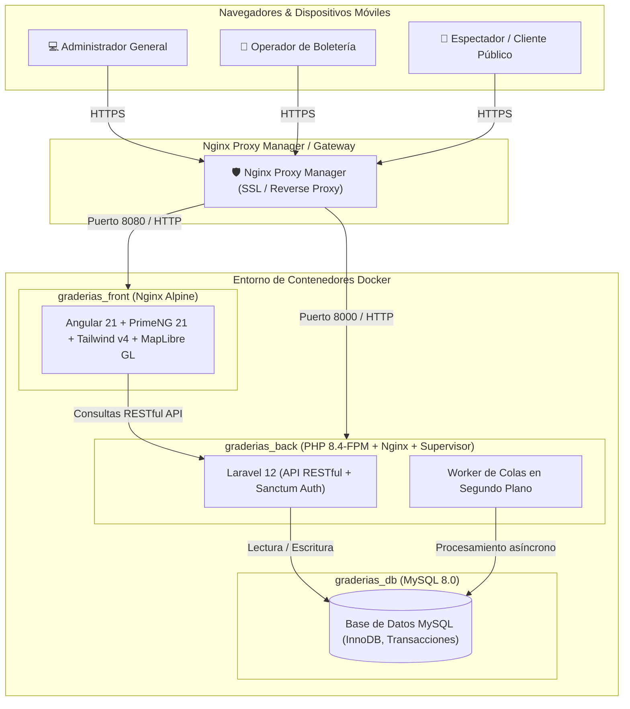
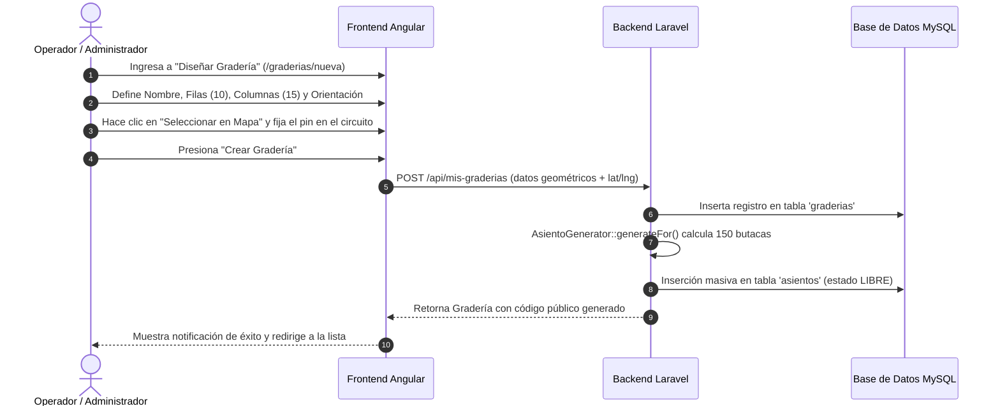
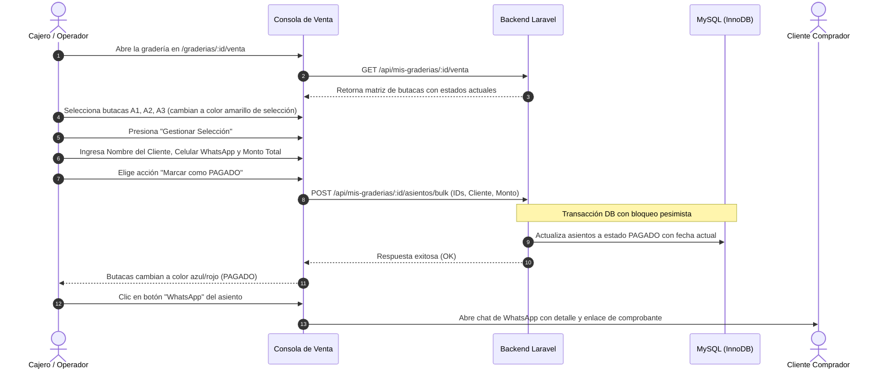

# 🏟️ Sistema de Gestión, Venta y Monitoreo Geoespacial de Graderías

> **Plataforma Integral para la Administración, Diseño Matricial, Venta de Butacas y Geolocalización en Tiempo Real de Graderías para el Carnaval de Oruro y Eventos Masivos.**


---

## 📑 Tabla de Contenidos

1. [Visión General del Sistema](#-visión-general-del-sistema)
2. [Arquitectura y Stack Tecnológico](#-arquitectura-y-stack-tecnológico)
3. [Módulos Principales y Capacidades](#-módulos-principales-y-capacidades)
   - [3.1. Diseñador Geométrico Matricial](#31-diseñador-geométrico-matricial)
   - [3.2. Mapa Interactivo Geoespacial (MapLibre GL)](#32-mapa-interactivo-geoespacial-maplibre-gl)
   - [3.3. Consola de Venta y Boletería en Vivo](#33-consola-de-venta-y-boletería-en-vivo)
   - [3.4. Catálogo Público para Clientes (`/g/:code`)](#34-catálogo-público-para-clientes-gcode)
   - [3.5. Panel de Control y Métricas en Tiempo Real (Dashboard)](#35-panel-de-control-y-métricas-en-tiempo-real-dashboard)
   - [3.6. Auditoría, Reportes Financieros y Liquidación](#36-auditoría-reportes-financieros-y-liquidación)
4. [Roles y Matriz de Acceso](#-roles-y-matriz-de-acceso)
5. [Flujos de Trabajo del Sistema](#-flujos-de-trabajo-del-sistema)
6. [Despliegue con Docker y Docker Compose](#-despliegue-con-docker-y-docker-compose)
7. [Manual de Configuración con NGINX PROXY MANAGER (NPM)](#-manual-de-configuración-con-nginx-proxy-manager-npm)
   - [7.1. Arquitectura de Red y Direcciones IP](#71-arquitectura-de-red-y-direcciones-ip)
   - [7.2. Escenario A: Despliegue con Subdominios y SSL (Recomendado)](#72-escenario-a-despliegue-con-subdominios-y-ssl-recomendado)
   - [7.3. Escenario B: Despliegue en Red Local (LAN) por IP y Puertos](#73-escenario-b-despliegue-en-red-local-lan-por-ip-y-puertos)
   - [7.4. Escenario C: Despliegue en un Solo Dominio con Enrutamiento por Ruta (`/api`)](#74-escenario-c-despliegue-en-un-solo-dominio-con-enrutamiento-por-ruta-api)
8. [Ejecución Local en Desarrollo (Sin Docker)](#-ejecución-local-en-desarrollo-sin-docker)
9. [Credenciales por Defecto y Datos de Prueba](#-credenciales-por-defecto-y-datos-de-prueba)
10. [Solución de Problemas Frecuentes (FAQ)](#-solución-de-problemas-frecuentes-faq)

---

## 🌟 Visión General del Sistema

El **Sistema de Graderías** es una solución web empresarial desarrollada para digitalizar, controlar y transparentar la venta de asientos temporales en eventos masivos de alta demanda, con foco prioritario en el **Carnaval de Oruro**.

### Principales Problemas que Resuelve:
- ❌ **Elimina el descontrol manual:** Sustituye cuadernos y mapas en papel por matrices interactivas computarizadas.
- 🚫 **Prevención de sobreventa y doble asignación:** Bloqueo de butacas con estados en tiempo real (`LIBRE`, `RESERVADO`, `PAGADO`, `BLOQUEADO`).
- 📍 **Ubicación geoespacial exacta:** Mapa interactivo con pines georreferenciados en el recorrido oficial del Carnaval.
- 📱 **Atención inmediata al cliente:** Registro de nombre y teléfono con botón directo de **WhatsApp** para envío de comprobantes y enlaces de confirmación.
- 📊 **Auditoría e ingresos en vivo:** Dashboards diferenciados para el **Administrador General** (control global del evento) y los **Operadores de Boletería** (control de sus propios sectores y recaudación diaria).

---

## 🏗️ Arquitectura y Stack Tecnológico

El sistema sigue una arquitectura desacoplada y moderna orientada a servicios RESTful:



### Componentes Tecnológicos:
- **Backend:** **Laravel 12** con PHP 8.4, Laravel Sanctum (Tokens Bearer), Spatie Laravel Permission, DomPDF, Simple QrCode, Owen-It Auditing.
- **Frontend:** **Angular 21** (Standalone Components, Signals reactivas, Redux Signal Stores), **PrimeNG 21** (Presets Aura/Lara, Sakai Admin Template), **Tailwind CSS v4**, **MapLibre GL** con tiles vectoriales OpenFreeMap.
- **Base de Datos:** **MySQL 8.0** con transacciones atómicas `InnoDB`.
- **Infraestructura:** Docker Compose, Nginx Alpine, Supervisor, Nginx Proxy Manager.

---

## 🚀 Módulos Principales y Capacidades

### 3.1. Diseñador Geométrico Matricial
- Creación rápida de graderías ingresando dimensiones: **filas** (ej. 10) y **columnas** (ej. 20).
- Algoritmo generador matricial (`AsientoGenerator`) que genera automáticamente la nomenclatura alfabética/numérica:
  - Modo Filas: Letras en filas (`A1`, `A2`... `B1`, `B2`).
  - Modo Columnas: Letras en columnas (`1A`, `1B`... `2A`, `2B`).
- Orientación configurable:
  - Fila 1 arriba o abajo (`start_top`).
  - Columna 1 a la izquierda o derecha (`start_left`).
- Asignación de propietario/operador responsable.

### 3.2. Mapa Interactivo Geoespacial (MapLibre GL)
- Mapa dinámico basado en MapLibre GL y estilos OpenFreeMap (modo claro y oscuro según el tema de la aplicación).
- **Selector interactivo de coordenadas:** Al crear o editar una gradería, el usuario puede abrir el mapa, hacer clic sobre cualquier punto del recorrido o arrastrar el pin para capturar con precisión milimétrica la latitud y longitud.
- **Pines y Popups en Vivo:** Cada gradería cuenta con un marcador con badge de color y popup interactivo que despliega:
  - Nombre del sector y dirección física.
  - Aforo total, butacas libres, reservadas y vendidas.
  - Barra de progreso de ocupación en porcentaje.
  - Botón directo para ingresar a la **Boletería**.
- **Aislamiento por Rol:**
  - El **Administrador** visualiza la totalidad de graderías del circuito.
  - El **Operador** visualiza exclusivamente sus sectores asignados.

### 3.3. Consola de Venta y Boletería en Vivo
- Vista visual interactiva de la matriz de butacas con colores según su estado:
  - 🟢 **LIBRE:** Asiento disponible para compra o reserva.
  - 🟡 **RESERVADO:** Apartado temporalmente.
  - 🔵 **PAGADO:** Cobrado y confirmado.
  - ⚪ **BLOQUEADO:** Fuera de venta (pasillos, columnas estructurales, seguridad).
- **Selección múltiple (Lotes):** El operador puede seleccionar varias butacas simultáneamente con un clic y cambiar su estado en bloque.
- **Cobro y Registro de Cliente:** Al pasar a `PAGADO` o `RESERVADO`, se registra:
  - Nombre completo del comprador.
  - Número de teléfono celular / WhatsApp.
  - Monto total cobrado (distribuido proporcionalmente en cada asiento).
- **Integración con WhatsApp:** Botón que abre automáticamente una conversación con el cliente con el mensaje de confirmación y el detalle de sus butacas.
- **Emisión de Tickets y Recibos:**
  - Ticket individual con código QR para control de acceso.
  - Planilla consolidada por cliente con todas sus butacas compradas.

### 3.4. Catálogo Público para Clientes (`/g/:code`)
- Enlace alfanumérico único por gradería (ejemplo: `https://tusitio.com/g/33ANPJHKVJ`).
- **Acceso 100% público sin login:** Los espectadores escanean el código QR o abren el enlace desde su celular para verificar en tiempo real:
  - Qué asientos están libres y cuáles ya están ocupados.
  - La dirección exacta y referencias del sector.
  - Botón para llamar o contactar por WhatsApp al operador dueño de la gradería para consultar precios y adquirir sus entradas.

### 3.5. Panel de Control y Métricas en Tiempo Real (Dashboard)
El panel de inicio (`/`) se adapta automáticamente según el rol del usuario autenticado:

#### 👑 Vista Administrador General:
- **6 Tarjetas de KPIs Globales:** Recaudación acumulada del evento, aforo total ocupado, ventas realizadas en la jornada (hoy), reservas pendientes por cobrar, sectores activos y total de cajeros en operación.
- **Ranking y Desempeño de Operadores:** Tabla ordenada por recaudación con total de graderías a su cargo, butacas cobradas y botón para inspeccionar su liquidación.
- **Monitor de Sectores:** Lista de graderías con indicador de estado y acceso directo a boletería.
- **Evolución Diaria de Recaudación:** Historial cronológico día por día con récord de recaudación y butacas vendidas.
- **Auditoría en Vivo:** Feed en tiempo real de los últimos cobros registrados en cualquier sector del evento.
- **Accesos Rápidos Globales:** Enlaces a Mapa, Seguimiento de Ventas, Diseñar Gradería, Gestión de Usuarios y Exportación de PDF General.

#### 🎫 Vista Operador de Boletería:
- **4 Tarjetas de KPIs Personales:** Mi recaudación acumulada, aforo comprometido en mis graderías, mis cobros de la jornada de hoy y monto por cobrar en reservas activas.
- **Mis Graderías Asignadas:** Tabla con mis sectores, aforo, estado y botones de Boletería, Reportes Financieros y copia de enlace público.
- **Mis Últimos Cobros:** Tabla de los cobros recientes realizados por mi usuario con botón directo de WhatsApp.
- **Evolución Diaria Personal:** Desglose día por día de mis ventas con botón para ver el detalle de asientos cobrados en cada fecha.
- **Accesos Rápidos del Operador:** Atajos directos a *Mis Graderías*, *Diseñar Gradería*, *Mapa de Graderías* y *Mis Reportes*.

### 3.6. Auditoría, Reportes Financieros y Liquidación
- **Modal Unificado de Reportes:** Permite consultar los ingresos diarios tanto de una gradería individual como de todas las graderías consolidadas de un operador.
- **Generación de Reportes PDF:**
  - Reporte consolidado de auditoría de operadores.
  - Reporte financiero diario con desglose de asientos vendidos y montos totales en Bolivianos (Bs).
  - Comprobantes térmicos aptos para impresoras POS de 80mm.

---

## 👥 Roles y Matriz de Acceso

| Capacidad / Módulo | Administrador General | Operador de Boletería | Espectador / Público |
|---|:---:|:---:|:---:|
| Ver Métricas y KPIs Globales del Evento | ✅ | ❌ (Solo ve sus métricas) | ❌ |
| Diseñar y Crear Nuevas Graderías | ✅ | ✅ | ❌ |
| Ver Todas las Graderías en el Mapa | ✅ | ❌ (Solo sus graderías) | ❌ |
| Vender y Cobrar Butacas en Boletería | ✅ (En cualquier gradería) | ✅ (En sus graderías) | ❌ |
| Contactar Cliente por WhatsApp con Boleto | ✅ | ✅ | ❌ |
| Reportes de Ingresos Diarios Personales | ✅ | ✅ | ❌ |
| Ranking y Liquidación de Otros Operadores | ✅ | ❌ | ❌ |
| Gestión de Usuarios y Permisos | ✅ | ❌ | ❌ |
| Personalización de Tema Visual y Colores | ✅ | ❌ | ❌ |
| Consultar Disponibilidad de Butacas en Vivo | ✅ | ✅ | ✅ (`/g/:code`) |

---

## 🔄 Flujos de Trabajo del Sistema

### Flujo 1: Alta y Geolocalización de una Gradería


### Flujo 2: Venta de Asientos en Boletería


---

## 🐳 Despliegue con Docker y Docker Compose

El proyecto está 100% contenerizado para levantarse en cualquier servidor Linux, VPS o máquina local con un único comando.

### Requisitos Previos:
- **Docker Engine** (versión 24 o superior): `docker -v`
- **Docker Compose** (versión v2.20 o superior): `docker compose version`

### Estructura de Contenedores:
1. **`graderias_db`**: Base de datos MySQL 8.0 con volumen persistente `graderias_db_data`.
2. **`graderias_back`**: Laravel 12 con PHP 8.4-FPM + Nginx interno + Supervisor en el puerto `8000`.
3. **`graderias_front`**: Angular 21 compilado y servido por Nginx Alpine en el puerto `8080`.

---

### Paso 1: Clonar el Repositorio
```bash
git clone https://github.com/tu-usuario/graderias.git
cd graderias
```

### Paso 2: Crear el Archivo de Variables de Entorno
Copia la plantilla preconfigurada de Docker:
```bash
cp .env.docker.example .env
```

Edita el archivo `.env` según tus necesidades de puertos y contraseñas:
```dotenv
# Puertos en el servidor Host
FRONTEND_PORT=8080
BACKEND_PORT=8000
DB_PORT=3306

# Credenciales de la Base de Datos
DB_DATABASE=back_graderias
DB_USERNAME=graderias_user
DB_PASSWORD=TuPasswordSeguro2026!
DB_ROOT_PASSWORD=TuRootPasswordSeguro2026!

# URLs públicas (ver sección de Nginx Proxy Manager)
BACKEND_URL=http://localhost:8000
PUBLIC_API_URL=http://localhost:8000/api
PUBLIC_AVATAR_URL=http://localhost:8000/images
```

### Paso 3: Construir y Levantar los Contenedores
```bash
docker compose up -d --build
```

El script de inicio automático de Laravel se encargará de:
1. Esperar a que MySQL esté 100% listo.
2. Ejecutar las migraciones de base de datos (`php artisan migrate --force`).
3. Generar la clave de encriptación (`APP_KEY`) si no existiera.
4. Crear el enlace simbólico de almacenamiento (`php artisan storage:link`).
5. Crear el usuario Administrador y permisos iniciales automáticamente si la base de datos está vacía.

### Paso 4: Verificar el Estado de los Contenedores
```bash
docker compose ps
```
Deberás ver los tres servicios en estado `Up`:
```text
NAME               IMAGE                     STATUS                   PORTS
graderias_db       mysql:8.0                 Up (healthy)             0.0.0.0:3306->3306/tcp
graderias_back     graderias-graderias_back  Up                       0.0.0.0:8000->8000/tcp
graderias_front    graderias-graderias_front Up                       0.0.0.0:8080->80/tcp
```

### Comandos de Utilidad con Docker:
```bash
# Ver logs en vivo de todos los contenedores
docker compose logs -f

# Ver logs solo del backend (Laravel)
docker compose logs -f graderias_back

# Ver logs solo del frontend (Nginx/Angular)
docker compose logs -f graderias_front

# Ejecutar comandos de Artisan dentro del contenedor
docker compose exec graderias_back php artisan route:list
docker compose exec graderias_back php artisan tinker

# Reiniciar los contenedores
docker compose restart

# Detener los contenedores (los datos de MySQL se conservan en el volumen)
docker compose down

# Reiniciar base de datos desde cero (⚠️ borra todos los datos)
docker compose down -v
docker compose up -d
```

---

## 🛡️ Manual de Configuración con NGINX PROXY MANAGER (NPM)

**Nginx Proxy Manager (NPM)** es una interfaz web intuitiva para administrar proxies inversos, redirecciones y certificados SSL gratuitos de **Let's Encrypt**.

### 7.1. Arquitectura de Red y Direcciones IP

Identifica la **IP de tu servidor** (ejecuta `ip a` o `hostname -I` en Linux).
- Supongamos que la IP de tu servidor es: `192.168.1.100` (o la IP pública de tu VPS: `203.0.113.50`).
- El contenedor Frontend escucha en el puerto host: `8080`.
- El contenedor Backend escucha en el puerto host: `8000`.

```text
┌────────────────────────────────────────────────────────────────────────┐
│                        INTERNET / RED LOCAL                            │
└────────────────────────────────────┬───────────────────────────────────┘
                                     │ (Puertos 80 y 443)
                                     ▼
                ┌────────────────────────────────────────┐
                │          NGINX PROXY MANAGER           │
                │        (Proxy inverso con SSL)         │
                └────────────────────┬───────────────────┘
                                     │
           ┌─────────────────────────┴─────────────────────────┐
           │                                                   │
           ▼ (Hacia http://192.168.1.100:8080)                 ▼ (Hacia http://192.168.1.100:8000)
┌───────────────────────┐                           ┌───────────────────────┐
│    graderias_front    │                           │    graderias_back     │
│   (Frontend Angular)  │                           │   (Backend Laravel)   │
└───────────────────────┘                           └───────────────────────┘
```

---

### 7.2. Escenario A: Despliegue con Subdominios y SSL (Recomendado para Producción)

Es la configuración profesional estándar:
- **Frontend:** `https://graderias.tudominio.com`
- **Backend API:** `https://api.graderias.tudominio.com`

#### Paso A.1: Configurar el archivo `.env` del proyecto
En tu archivo `.env` de la raíz del proyecto, define las URLs públicas de tus subdominios:
```dotenv
FRONTEND_PORT=8080
BACKEND_PORT=8000

BACKEND_URL=https://api.graderias.tudominio.com
PUBLIC_API_URL=https://api.graderias.tudominio.com/api
PUBLIC_AVATAR_URL=https://api.graderias.tudominio.com/images
```
Reinicia el frontend para que tome las nuevas URLs:
```bash
docker compose restart graderias_front
```
> **Nota técnica:** Gracias a la inyección en tiempo de ejecución (`assets/env.js`), el frontend actualizará la URL de la API **al instante sin necesidad de recompilar Angular**.

#### Paso A.2: Crear el Proxy Host para el FRONTEND en NPM
1. Ingresa al panel de Nginx Proxy Manager (usualmente en el puerto `81`, ej: `http://192.168.1.100:81`).
2. Ve a **Hosts** > **Proxy Hosts** > **Add Proxy Host**.
3. Pestaña **Details**:
   - **Domain Names:** `graderias.tudominio.com`
   - **Scheme:** `http`
   - **Forward Hostname / IP:** `192.168.1.100` *(o `graderias_front` si NPM está en la misma red Docker)*
   - **Forward Port:** `8080` *(o `80` si usas nombre de contenedor)*
   - Activa:
     - ✅ **Cache Assets**
     - ✅ **Block Common Exploits**
     - ✅ **Websockets Support**
4. Pestaña **SSL**:
   - **SSL Certificate:** *Request a new SSL Certificate*
   - Activa:
     - ✅ **Force SSL**
     - ✅ **HTTP/2 Support**
     - ✅ **HSTS Enabled**
   - Ingresa tu correo y acepta los términos de Let's Encrypt.
5. Presiona **Save**.

#### Paso A.3: Crear el Proxy Host para el BACKEND en NPM
1. En Nginx Proxy Manager, pulsa **Add Proxy Host**.
2. Pestaña **Details**:
   - **Domain Names:** `api.graderias.tudominio.com`
   - **Scheme:** `http`
   - **Forward Hostname / IP:** `192.168.1.100` *(o `graderias_back` si NPM está en la misma red Docker)*
   - **Forward Port:** `8000`
   - Activa:
     - ✅ **Block Common Exploits**
     - ✅ **Websockets Support**
3. Pestaña **SSL**:
   - Solicita certificado SSL con **Force SSL** y **HTTP/2 Support**.
4. Pestaña **Advanced** (Ajuste de subida de archivos para avatares grandes):
   Pega lo siguiente:
   ```nginx
   client_max_body_size 64M;
   proxy_read_timeout 300;
   proxy_connect_timeout 300;
   proxy_send_timeout 300;
   ```
5. Presiona **Save**.

¡Listo! Ya puedes ingresar a `https://graderias.tudominio.com` de forma segura con candado SSL.

---

### 7.3. Escenario B: Despliegue en Red Local (LAN) por IP y Puertos (Sin Dominio)

Si vas a operar en una red local cerrada (por ejemplo, en las oficinas de venta del Carnaval de Oruro mediante Wi-Fi o red cableada sin dominio de internet):

1. Obtén la IP local del servidor donde corre Docker:
   ```bash
   hostname -I
   # Ejemplo: 192.168.1.50
   ```
2. Edita `.env` en la raíz del proyecto:
   ```dotenv
   FRONTEND_PORT=8080
   BACKEND_PORT=8000

   BACKEND_URL=http://192.168.1.50:8000
   PUBLIC_API_URL=http://192.168.1.50:8000/api
   PUBLIC_AVATAR_URL=http://192.168.1.50:8000/images
   ```
3. Reinicia el frontend:
   ```bash
   docker compose restart graderias_front
   ```
4. Cualquier dispositivo (computadora, tablet o celular) conectado a la misma red Wi-Fi podrá acceder abriendo:
   - **Sistema Web:** `http://192.168.1.50:8080`
   - **API Backend:** `http://192.168.1.50:8000`

---

### 7.4. Escenario C: Despliegue en un Solo Dominio con Enrutamiento por Ruta (`/api`)

Si solo tienes **un único dominio** (ej. `graderias.tudominio.com`) y deseas que tanto el frontend como la API compartan el mismo dominio:

1. Configura `.env`:
   ```dotenv
   BACKEND_URL=https://graderias.tudominio.com
   PUBLIC_API_URL=/api
   PUBLIC_AVATAR_URL=/images
   ```
2. Reinicia el contenedor frontend:
   ```bash
   docker compose restart graderias_front
   ```
3. En Nginx Proxy Manager, crea un solo Proxy Host para `graderias.tudominio.com`:
   - **Forward IP / Port:** `192.168.1.100` : `8080` (Apunta al frontend).
4. En la pestaña **Custom Locations** del mismo Proxy Host, añade 3 reglas:
   - **Location 1:** `/api`
     - Scheme: `http` | Forward IP: `192.168.1.100` | Port: `8000`
   - **Location 2:** `/images`
     - Scheme: `http` | Forward IP: `192.168.1.100` | Port: `8000`
   - **Location 3:** `/storage`
     - Scheme: `http` | Forward IP: `192.168.1.100` | Port: `8000`
5. Guarda los cambios. Esto elimina 100% cualquier posible problema de CORS entre orígenes distintos.

---

## 💻 Ejecución Local en Desarrollo (Sin Docker)

Si deseas trabajar en el código fuente directamente en tu máquina local sin utilizar contenedores:

### Requisitos:
- PHP 8.2 o superior (probado en PHP 8.4) con extensiones `pdo_mysql`, `mbstring`, `gd`, `zip`, `fileinfo`.
- Composer 2.x
- Node.js 20, 22 o 24 LTS
- Servidor MySQL local activo

---

### 1. Levantar el Backend (Laravel 12):
```bash
cd back

# 1. Instalar dependencias
composer install

# 2. Configurar variables de entorno
cp .env.example .env
# Configura DB_DATABASE, DB_USERNAME y DB_PASSWORD en tu .env

# 3. Generar APP_KEY
php artisan key:generate

# 4. Migrar y poblar la base de datos
php artisan migrate --seed

# 5. Enlazar almacenamiento de archivos
php artisan storage:link

# 6. Iniciar servidor local
php artisan serve
```
El backend estará disponible en: **`http://localhost:8000`**.

---

### 2. Levantar el Frontend (Angular 21):
```bash
cd front_ng

# 1. Instalar dependencias
npm install

# 2. Iniciar servidor de desarrollo de Angular
npm start
```
El frontend estará disponible en: **`http://localhost:4200`** (con recarga en vivo ante cambios en el código).

---

## 🔑 Credenciales por Defecto y Datos de Prueba

El comando `db:seed` crea automáticamente los siguientes accesos:

### 👑 Usuario Administrador General:
- **Usuario:** `admin`
- **Contraseña:** `admin123Admin`
- **Rol:** `Administrador`
- **Permisos:** Acceso completo a todos los módulos, ranking de operadores, diseño de graderías, auditoría de ventas y gestión de usuarios.

### 🎫 Usuario Operador de Prueba:
- **Usuario:** `usuario01`
- **Contraseña:** `usuario01` *(o la clave configurada en el sistema)*
- **Rol:** `Usuario` (Operador de Boletería)
- **Permisos:** Acceso a sus graderías asignadas, consola de venta de butacas, reportes personales y visualización de sus sectores en el mapa.

---

## ❓ Solución de Problemas Frecuentes (FAQ)

### 1. ¿Cómo cambio el tema visual (colores primarios o modo oscuro)?
El sistema incluye un módulo de personalización en `/personalizacion`. Puedes elegir entre los presets **Aura**, **Lara** y **Nora**, cambiar el color de superficie y activar el modo oscuro.

### 2. Al cambiar la URL del backend en Docker, el frontend sigue llamando a la anterior.
Ejecuta:
```bash
docker compose restart graderias_front
```
Y en tu navegador presiona `Ctrl + Shift + R` (o `Cmd + Shift + R` en Mac) para vaciar la memoria caché de scripts.

### 3. Error de CORS en el navegador (`Cross-Origin Request Blocked`).
Verifica que en `back/config/cors.php` los paths incluyan `'paths' => ['api/*', 'sanctum/csrf-cookie', 'images/*', 'storage/*']` y que `allowed_origins` esté en `['*']`.

### 4. ¿Cómo realizo un respaldo de la base de datos de Docker?
```bash
docker compose exec graderias_db mysqldump -u graderias_user -pgraderias_pass back_graderias > backup_graderias_$(date +%Y%m%d).sql
```

### 5. ¿Cómo restauro un respaldo SQL?
```bash
docker compose exec -T graderias_db mysql -u graderias_user -pgraderias_pass back_graderias < backup_graderias_20261113.sql
```

---

<div align="center">
  <b>Desarrollado con ❤️ para el Carnaval de Oruro y la gestión profesional de espectáculos masivos.</b>
</div>
