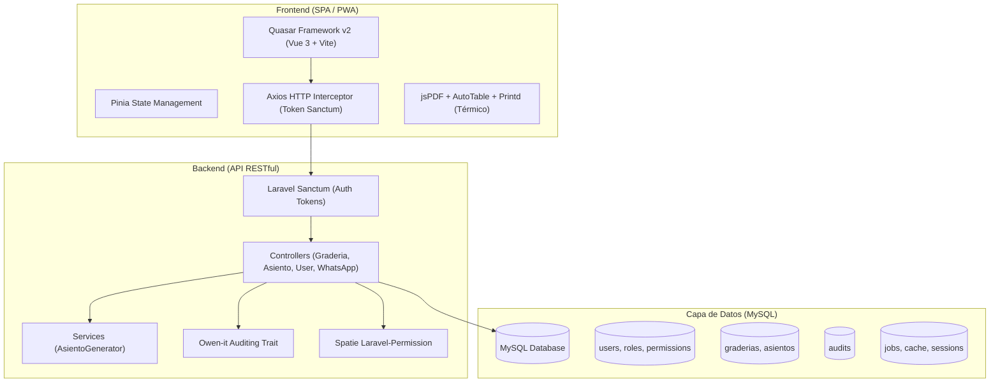
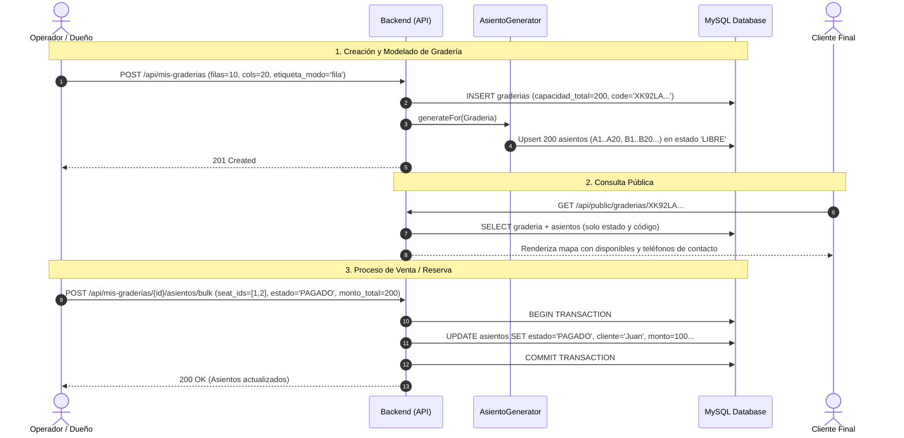
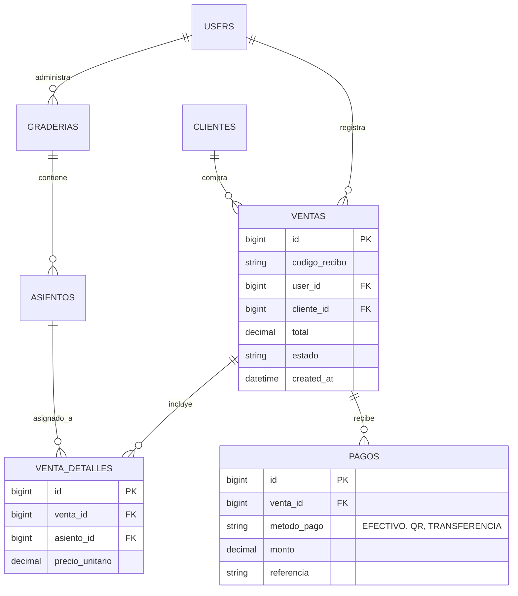

# DOCUMENTO TÉCNICO Y DE ARQUITECTURA: SISTEMA DE GESTIÓN Y VENTA DE GRADERÍAS

Este documento detalla a profundidad la estructura interna, base de datos, backend, flujos de negocio, manejo de concurrencia, roles, permisos y áreas de mejora del sistema actual (**Versión 1.0**), sirviendo como guía maestra para la auditoría, exploración y desarrollo de la **Versión 2.0**.

---

## 1. RESUMEN EJECUTIVO Y PROPÓSITO DEL SISTEMA

El sistema es una solución integral orientada a la **organización, dimensionamiento espacial, reserva y venta de asientos en graderías temporales o permanentes** (frecuentemente utilizado en eventos masivos, desfiles folclóricos como el Carnaval de Oruro, conciertos y festivales deportivos).

### Objetivos funcionales del sistema:
1. **Modelado matricial de graderías:** Permitir a un usuario definir filas, columnas, orientación de conteo (arriba-abajo, izquierda-derecha) y nomenclatura de etiquetas (A1, B2 o 1A, 2B).
2. **Generación automática de asientos:** Generar de forma masiva miles de registros de butacas en base a las dimensiones configuradas.
3. **Gestión de estados:** Administrar el ciclo de vida de cada asiento (`LIBRE`, `RESERVADO`, `PAGADO`, `BLOQUEADO`).
4. **Punto de venta y reservas:** Permitir a operadores seleccionar asientos individualmente o en bloque, asignar datos del cliente, calcular montos y registrar pagos.
5. **Enlace público (Catálogo de disponibilidad):** Proveer un enlace web único y público por gradería para que los clientes finales vean en tiempo real la disponibilidad y números de contacto para adquirir sus boletos.
6. **Emisión de boletos e impresión:** Generación de recibos térmicos, tickets individuales por asiento y listas de clientes mediante PDF.

---

## 2. ARQUITECTURA TECNOLÓGICA



### Componentes de software:
- **Backend:** Laravel 12.x (PHP 8.2+).
- **Autenticación:** Laravel Sanctum (Tokens personales `personal_access_tokens`).
- **Control de Acceso:** Spatie `laravel-permission` v6.24.
- **Auditoría:** `owen-it/laravel-auditing` v14.0 (audita cambios en usuarios, graderías y asientos).
- **Procesamiento de PDF e Imágenes:** `barryvdh/laravel-dompdf` v3.1, `simplesoftwareio/simple-qrcode` v4.2, `intervention/image` v3.11.
- **Frontend:** Quasar Framework v2 (Vue 3, Vite, Pinia, Vue-ApexCharts).
- **Base de Datos:** MySQL / MariaDB (motor InnoDB).

---

## 3. DICCIONARIO DE DATOS Y ESQUEMA DE BASE DE DATOS

A continuación se describe cada tabla, sus campos, tipos, restricciones y el propósito específico de negocio dentro del sistema.

### 3.1. Tabla: `users`
Almacena las credenciales y perfiles de los operadores y administradores del sistema.

| Campo | Tipo | Nulo | Por Defecto | Descripción y Reglas de Negocio |
|---|---|---|---|---|
| `id` | `BIGINT UNSIGNED` | NO | Auto | Identificador primario del usuario. |
| `name` | `VARCHAR(255)` | SÍ | NULL | Nombre completo del operador/administrador. |
| `username` | `VARCHAR(255)` | SÍ | NULL | Nombre de usuario único utilizado para iniciar sesión. |
| `email` | `VARCHAR(255)` | SÍ | NULL | Correo electrónico institucional o personal. |
| `clave` | `VARCHAR(255)` | SÍ | NULL | ⚠️ **VULNERABILIDAD CRÍTICA:** Almacena la contraseña en texto plano. Se actualiza en `UserController@changeMyPassword` y `adminResetPassword`. |
| `telefono_contacto_1` | `VARCHAR(30)` | SÍ | NULL | Teléfono público de contacto (se muestra a clientes en el visor público de la gradería). |
| `telefono_contacto_2` | `VARCHAR(30)` | SÍ | NULL | Teléfono secundario o de WhatsApp de contacto. |
| `avatar` | `VARCHAR(255)` | NO | 'default.png' | Nombre de archivo de la foto de perfil (guardada en `public/images/`). |
| `email_verified_at` | `TIMESTAMP` | SÍ | NULL | Fecha de verificación de correo (Laravel default). |
| `password` | `VARCHAR(255)` | NO | — | Hash seguro Bcrypt de la contraseña del usuario. |
| `role` | `VARCHAR(100)` | SÍ | 'Usuario' | Campo descriptivo de rol ('Administrador', 'Usuario'). |
| `remember_token` | `VARCHAR(100)` | SÍ | NULL | Token de sesión para "recordarme". |
| `created_at` / `updated_at` | `TIMESTAMP` | SÍ | NULL | Marcas de tiempo de creación y modificación. |
| `deleted_at` | `TIMESTAMP` | SÍ | NULL | SoftDeletes (borrado lógico de usuarios). |

---

### 3.2. Tabla: `graderias`
Representa la infraestructura física o sector de tribunas que posee un usuario. Define la matriz geométrica del espacio.

| Campo | Tipo | Nulo | Por Defecto | Descripción y Reglas de Negocio |
|---|---|---|---|---|
| `id` | `BIGINT UNSIGNED` | NO | Auto | Identificador primario. |
| `user_id` | `BIGINT UNSIGNED` | SÍ | NULL | Foránea a `users.id`. Define al **dueño** de la gradería. Los endpoints validan que sólo el dueño opere su gradería. |
| `nombre` | `VARCHAR(120)` | SÍ | NULL | Nombre identificatorio (ej: "Gradería Socavón Sector A"). |
| `codigo` | `VARCHAR(40)` | SÍ | NULL | Código interno opcional (ej: "G-001"). |
| `code` | `VARCHAR(32)` | NO | — | **Token público único:** Cadena alfanumérica de 10 caracteres (`Str::upper(Str::random(10))`) para acceso público (`/g/{code}`). |
| `direccion` | `VARCHAR(255)` | SÍ | NULL | Ubicación física o calle donde se emplaza la gradería. |
| `ref_izquierda` | `VARCHAR(255)` | SÍ | NULL | Punto de referencia visual al lado izquierdo. |
| `ref_derecha` | `VARCHAR(255)` | SÍ | NULL | Punto de referencia visual al lado derecho. |
| `ref_frente` | `VARCHAR(255)` | SÍ | NULL | Referencia hacia lo que se visualiza al frente (ej: "Paso de fraternidades"). |
| `filas` | `SMALLINT UNSIGNED` | NO | 0 | Número de filas (Eje X o vertical de asientos). Máx: 500. |
| `columnas` | `SMALLINT UNSIGNED` | NO | 0 | Número de columnas (Eje Y o horizontal de asientos). Máx: 500. |
| `capacidad_total` | `INT UNSIGNED` | NO | 0 | Capacidad teórica calculada (`filas * columnas`). |
| `etiqueta_modo` | `ENUM('fila','columna')` | NO | 'fila' | Modo de codificación: <br>• `'fila'`: Filas con letras y columnas con números (A1, A2, B1...). <br>• `'columna'`: Columnas con letras y filas con números (A1, B1, C1...). |
| `start_top` | `BOOLEAN` | NO | 1 (true) | `true`: Conteo inicia arriba (fila 1 arriba). `false`: Conteo inicia abajo. |
| `start_left` | `BOOLEAN` | NO | 1 (true) | `true`: Conteo inicia a la izquierda. `false`: Inicia a la derecha. |
| `activo` | `BOOLEAN` | NO | 1 (true) | Habilita o deshabilita la visualización pública de la gradería. |
| `created_at` / `updated_at` | `TIMESTAMP` | SÍ | NULL | Marcas de tiempo de auditoría. |
| `deleted_at` | `TIMESTAMP` | SÍ | NULL | SoftDeletes (borrado lógico). |

---

### 3.3. Tabla: `asientos`
Representa cada butaca individual dentro de la matriz de la gradería.

| Campo | Tipo | Nulo | Por Defecto | Descripción y Reglas de Negocio |
|---|---|---|---|---|
| `id` | `BIGINT UNSIGNED` | NO | Auto | Identificador primario del asiento. |
| `graderia_id` | `BIGINT UNSIGNED` | NO | — | Clave foránea con eliminación en cascada hacia `graderias.id`. |
| `fila` | `SMALLINT UNSIGNED` | SÍ | NULL | Índice numérico de fila (1 a N). |
| `columna` | `SMALLINT UNSIGNED` | SÍ | NULL | Índice numérico de columna (1 a N). |
| `codigo` | `VARCHAR(10)` | NO | — | Código visible en boleto (ej: "A1", "C14"). Generado por `AsientoGenerator`. |
| `descripcion` | `VARCHAR(120)` | SÍ | NULL | Comentario o nota física (ej: "Con sombra", "Baranda"). |
| `estado` | `ENUM(...)` | NO | 'LIBRE' | Estados posibles: `LIBRE`, `RESERVADO`, `PAGADO`, `BLOQUEADO`. |
| `cliente_nombre` | `VARCHAR(180)` | SÍ | NULL | Nombre completo del comprador o reservante. |
| `cliente_celular` | `VARCHAR(30)` | SÍ | NULL | Teléfono/WhatsApp del cliente para contacto y envío de boleto. |
| `monto` | `DECIMAL(10,2)` | SÍ | NULL | Precio cobrado o acordado por este asiento en específico. |
| `reservado_at` | `TIMESTAMP` | SÍ | NULL | Fecha y hora exacta en que se marcó como `RESERVADO` o `PAGADO`. |
| `pagado_at` | `TIMESTAMP` | SÍ | NULL | Fecha y hora exacta en que se confirmó el pago (`PAGADO`). |
| `created_at` / `updated_at` | `TIMESTAMP` | SÍ | NULL | Marcas de tiempo. |
| `deleted_at` | `TIMESTAMP` | SÍ | NULL | SoftDeletes. |

#### Restricciones e Índices en `asientos`:
- **`UNIQUE KEY (graderia_id, codigo)`**: Impide que existan dos asientos con el mismo código en una misma gradería.
- **`INDEX (graderia_id, estado)`**: Optimiza las consultas de conteo y filtrado de estadísticas (libres vs vendidos).
- **`INDEX (cliente_celular)`**: Acelera búsquedas de reservas históricas por número de teléfono.

---

### 3.4. Tablas del Ecosistema de Roles y Permisos (Spatie Permission)
El sistema ejecuta la migración oficial de Spatie:
- `roles`: Roles creados (ej. "Administrador", "Usuario").
- `permissions`: Permisos atómicos del sistema (`Dashboard`, `Usuarios`, `Graderias`).
- `model_has_roles`: Relación polimórfica entre usuarios y roles.
- `model_has_permissions`: Relación directa entre usuarios y permisos específicos.
- `role_has_permissions`: Asignación de permisos pertenecientes a un rol.

---

### 3.5. Tabla de Auditoría: `audits` (Owen-it Auditing)
Registra de forma automática cualquier cambio (`created`, `updated`, `deleted`, `restored`) en los modelos `User`, `Graderia` y `Asiento`.

| Campo | Descripción |
|---|---|
| `user_type`, `user_id` | Identidad del usuario autenticado que ejecutó la acción. |
| `event` | Acción ejecutada (`created`, `updated`, `deleted`). |
| `auditable_type`, `auditable_id` | Modelo afectado (`App\Models\Asiento`, `App\Models\Graderia`, etc.). |
| `old_values` | JSON con los valores antes de la modificación. |
| `new_values` | JSON con los nuevos valores guardados. |
| `url`, `ip_address`, `user_agent` | Metadatos de la petición HTTP origen. |

---

### 3.6. Tablas de Infraestructura y Cola
- `personal_access_tokens`: Tokens Bearer emitidos por Sanctum tras `/api/login`.
- `sessions`: Sesiones HTTP en base de datos (`SESSION_DRIVER=database`).
- `cache`, `cache_locks`: Cache de aplicación y bloqueos atómicos (`CACHE_STORE=database`).
- `jobs`, `job_batches`, `failed_jobs`: Almacenamiento de tareas asíncronas de Laravel (`QUEUE_CONNECTION=database`).

---

## 4. ANÁLISIS DE COLAS (QUEUES) Y SEEDERS

### 4.1. Configuración de Colas (Queues)
En el archivo de entorno `.env`:
```ini
QUEUE_CONNECTION=database
```
En `composer.json`, el script de desarrollo incluye:
```bash
php artisan queue:listen --tries=1
```
#### Estado real de las colas en el backend:
1. **La infraestructura existe:** Las tablas `jobs` y `failed_jobs` están migradas en la base de datos.
2. **Uso en código:** Existe una clase de correo `TicketPaidMail` que implementa la interfaz `ShouldQueue` y el trait `Queueable`. Su objetivo era compilar y enviar un PDF adjunto de entrada al cliente.
3. **Diagnóstico técnico:** **Actualmente no hay Jobs encolados en ejecución productiva.** Los controladores `AsientoController` y `GraderiaController` ejecutan todas las operaciones de manera síncrona. El controlador `WhatsAppController` no encola el envío a Meta, sino que retorna una respuesta inmediata con la ruta del archivo generado localmente.

### 4.2. Análisis de Seeders
Ubicados en `back/database/seeders/`:

1. **`DatabaseSeeder.php`**:
   - Crea el usuario Administrador por defecto:
     - **Username:** `admin`
     - **Contraseña:** `admin123Admin`
     - **Rol:** `Administrador`
   - Crea los permisos base: `Dashboard`, `Usuarios`, `Graderias`.
   - Asigna todos los permisos al usuario admin mediante `$userAdmin->givePermissionTo(Permission::all())`.
   - Tiene comentados otros permisos potenciales: `Reservas`, `Idiomas`, `Precios`, `Reportes`.

2. **`EventoSeeder.php` y `EventoHorarioSeeder.php`**:
   - ⚠️ **Código Huérfano / Vestigio:** Contienen registros de museos y templos de Egipto ("Giza Plateau", "Luxor Temple") y horarios de visita.
   - Estos archivos fueron heredados de un proyecto previo de reserva de tickets turísticos y **están comentados en `DatabaseSeeder.php`**, por lo que no afectan la ejecución, pero deben eliminarse para la Versión 2.0.

---

## 5. MANEJO DE ROLES Y PERMISOS

El sistema maneja la seguridad mediante una **combinación híbrida** entre un campo plano `role` en la tabla `users` y la librería Spatie Permissions.

### 5.1. Permisos Existentes y su Alcance

| Permiso | Acceso Backend | Acceso Frontend (Ruta) | Funcionalidad |
|---|---|---|---|
| `Dashboard` | Sin restricción estricta en API | Ruta `/` (Inicio) | Visualización del panel principal con métricas globales. |
| `Usuarios` | `UserController@adminResetPassword`, gestión de usuarios | Ruta `/usuarios` | CRUD de usuarios, reseteo de claves ajenas, cambio de avatares y sincronización de permisos. |
| `Graderias` | `GraderiaController`, `AsientoController` | Rutas `/mis-graderias/*` | Creación, configuración matricial, edición y venta de asientos. |

### 5.2. Cómo se Administran los Roles
1. **En la Creación de Usuarios (`UserController@store`):**
   - Cuando se crea un nuevo usuario, el sistema le asigna automáticamente los permisos base `Dashboard` y `Graderias`.
2. **Matriz de Permisos Personalizada (`UserController@updateUserPermissions`):**
   - Un administrador puede ingresar a la vista de Usuarios, seleccionar un usuario y marcar/desmarcar casillas de permisos específicos mediante `syncPermissions()`.
3. **Políticas y Control de Propiedad (`GraderiaPolicy`):**
   - Existe una política `GraderiaPolicy.php` que estipula:
     ```php
     public function view(User $user, Graderia $graderia): bool {
         return (int)$graderia->user_id === (int)$user->id;
     }
     ```
   - Sin embargo, en los controladores se valida manualmente mediante:
     ```php
     if ((int)$graderia->user_id !== (int)$request->user()->id) {
         return response()->json(['message' => 'No autorizado'], 403);
     }
     ```
   - ⚠️ **Deficiencia Detectada:** Un usuario con rol `Administrador` **no puede ver ni gestionar las graderías creadas por otros usuarios**, porque la condición exige estrictamente que `graderia.user_id === user.id`. No existe un bypass de superadministrador.

---

## 6. LÓGICA DE NEGOCIO PASO A PASO

A continuación se detalla el ciclo completo de operaciones dentro de la plataforma:



### Paso 1: Autenticación y Cierre de Sesiones
- El usuario ingresa `username` y `password` en `/api/login`.
- El backend verifica la contraseña con `password_verify` contra el hash Bcrypt de la base de datos.
- Se crea un token personal Sanctum `auth_token`.
- **Mecanismo de seguridad de cambio de clave (`changeMyPassword` y `adminResetPassword`):**
  - Al cambiar la contraseña, el sistema busca los tokens activos y los revoca (`$user->tokens()->where('id', '!=', $currentTokenId)->delete()`), cerrando la sesión en otros dispositivos.

### Paso 2: Creación Matricial de la Gradería
- El operador define:
  - Nombre y dirección física.
  - Dimensiones: `filas` y `columnas`.
  - Sentido de etiquetado: `fila` (A1, A2, B1...) o `columna` (A1, B1, C1...).
  - Sentido geométrico: `start_top` (si A1 está arriba o abajo) y `start_left` (si A1 está a la izquierda o derecha).
- El sistema genera un código público aleatorio único de 10 caracteres (`generateUniqueCode()`).
- Inmediatamente se invoca el servicio `AsientoGenerator::generateFor($graderia)`.

### Paso 3: Generación Algorítmica de Asientos (`AsientoGenerator`)
El generador utiliza el algoritmo de conversión de números base 26 a letras del alfabeto (alfabeto estilo Excel):
```php
private static function numToLetters(int $n): string {
    $s = '';
    while ($n > 0) {
        $n--;
        $s = chr(65 + ($n % 26)) . $s;
        $n = intdiv($n, 26);
    }
    return $s;
}
```
- Realiza inserciones masivas por lotes de **1,000 registros** usando `Asiento::upsert()`.
- Clave única de upsert: `['graderia_id', 'codigo']`.
- Esto garantiza que si se repara una gradería existente, no se dupliquen registros ni se borre el historial de asientos ya vendidos.

### Paso 4: Venta y Reserva de Asientos
Existen dos formas de venta en el frontend:
1. **Actualización Individual (`PATCH /mis-graderias/{g}/asientos/{a}`):**
   - Permite cambiar el estado de un asiento específico.
   - Si se pasa a `RESERVADO`: Exige `cliente_nombre`, `cliente_celular` y `monto`. Registra `reservado_at = now()`.
   - Si se pasa a `PAGADO`: Exige los mismos datos y asigna `pagado_at = now()`.
   - Si se pasa a `LIBRE` o `BLOQUEADO`: Limpia completamente los datos del cliente, monto y fechas.
2. **Actualización Masiva (`POST /mis-graderias/{g}/asientos/bulk`):**
   - Permite seleccionar un grupo de asientos (ej. 5 asientos) y asignar un `monto_total` global (ej. 350 Bs).
   - **Distribución aritmética inteligente:**
     ```php
     $montoBase = floor($data['monto_total'] / $count);
     $resto = $data['monto_total'] - ($montoBase * $count);
     ```
     El sistema distribuye los centavos/enteros sobrantes uno a uno en los primeros asientos para que la suma exacta de los asientos coincida con el total ingresado.

### Paso 5: Emisión de Boletos e Impresión
En el cliente Quasar:
- **Impresión por Asiento:** Genera con `jsPDF` una hoja por asiento con código QR, código de asiento, nombre de la gradería y datos del cliente.
- **Impresión por Cliente:** Genera una planilla resumen agrupando todos los asientos adquiridos por un cliente específico.
- **Recibo Térmico (80mm):** Implementado en `front/src/addons/Imprimir.js` con soporte para convertir montos a texto literal ("Son Cien 00/100 Bolivianos") y envío a impresoras POS vía `Printd`.

---

## 7. ANÁLISIS DE CONCURRENCIA: ¿CÓMO EVITA QUE SE VENDAN DOS ASIENTOS AL MISMO TIEMPO?

### ⚠️ DIAGNÓSTICO REAL: EL SISTEMA ACTUAL **NO LO EVITA** (RACE CONDITIONS PRESENTES)

Uno de los requerimientos más críticos en sistemas de boletería es evitar la sobreventa (**doble reserva o doble venta simultánea** de un mismo asiento cuando dos cajeros o clientes pulsan "Comprar" a la vez).

Al inspeccionar el código actual de `AsientoController.php`:
```php
// Fragmento de bulkUpdate:
$seats = Asiento::where('graderia_id', $graderia->id)
    ->whereIn('id', $data['seat_ids'])
    ->orderBy('id')
    ->get(); // <-- LECTURA SIN BLOQUEO PESIMISTA

DB::transaction(function () use ($seats, $data, $count) {
    foreach ($seats as $i => $s) {
        // Asigna cliente y nuevo estado...
        $s->save(); // <-- SOBREESCRIBE CIEGAMENTE
    }
});
```

#### Fallas de concurrencia identificadas en el código actual:
1. **Falta de Bloqueo Pesimista (`lockForUpdate`):** La consulta `Asiento::whereIn(...)` se ejecuta sin bloqueo de fila. Si dos peticiones llegan concurrentemente para el asiento ID `42`, ambas obtienen el registro con estado `LIBRE`.
2. **Falta de Validación de Estado Previo:** El controlador no valida que `$s->estado === 'LIBRE'` antes de aplicar el nuevo estado `PAGADO` o `RESERVADO`.
3. **Sobreescritura Silenciosa (Last-Write-Wins):** Si el Cajero A vende el asiento a "Pedro" a las `10:00:00.100` y el Cajero B lo vende a "María" a las `10:00:00.150`, la transacción del Cajero B sobreescribe a Pedro sin arrojar ningún error ni advertencia. Pedro tendrá su boleto impreso en mano, pero en la base de datos figurará María.
4. **El índice UNIQUE no previene esto:** El índice único es `['graderia_id', 'codigo']`. Esto sólo impide crear dos filas con el código `A1`. Pero como la fila `A1` ya existe, los dos cajeros sólo hacen un `UPDATE` sobre la misma fila.

### Cómo debe implementarse correctamente en la Versión 2.0 (Solución Arquitectónica)

Para garantizar consistencia ACID y cero doble ventas, existen dos estrategias obligatorias:

#### Opción A: Bloqueo Pesimista en Base de Datos (Pessimistic Locking)
```php
DB::transaction(function () use ($graderia, $seatIds, $datosCliente) {
    // 1. SELECT ... FOR UPDATE (bloquea las filas en InnoDB hasta el COMMIT)
    $seats = Asiento::where('graderia_id', $graderia->id)
        ->whereIn('id', $seatIds)
        ->lockForUpdate()
        ->get();

    // 2. Verificar que NINGUNO esté ocupado
    foreach ($seats as $seat) {
        if ($seat->estado !== 'LIBRE') {
            throw new \Exception("El asiento {$seat->codigo} ya fue vendido o reservado por otro usuario.");
        }
    }

    // 3. Aplicar venta atómica
    foreach ($seats as $seat) {
        $seat->estado = 'PAGADO';
        $seat->cliente_nombre = $datosCliente['nombre'];
        // ...
        $seat->save();
    }
});
```

#### Opción B: Bloqueo en Memoria Ultrarrápido con Redis (Hold / Reserva Temporal)
Cuando un cliente selecciona un asiento en la pantalla, se adquiere un Lock de Redis por 10 minutos:
```php
$lock = Cache::lock("seat_lock:{$graderiaId}:{$seatCode}", 600); // 10 min TTL
if (!$lock->get()) {
    return response()->json(['message' => 'Asiento en proceso de compra por otra persona'], 409);
}
```

---

## 8. MANEJO DE TRANSACCIONES Y ROLLBACKS

### 8.1. Estado Actual
- Tanto `AsientoGenerator` como `AsientoController` hacen uso de `DB::transaction(function () { ... })`.
- **Mecanismo de Rollback:** Laravel envuelve el bloque de código en `BEGIN` y `COMMIT`. Si ocurre una excepción no controlada (`throw new \Exception(...)`), el motor de base de datos ejecuta automáticamente un `ROLLBACK`.
- En `updateOne`:
  ```php
  if (empty($data['cliente_nombre']) || empty($data['cliente_celular']) || $data['monto'] === null) {
      throw new \Exception('Para PAGADO se requiere cliente, celular y monto.');
  }
  ```
  Al disparar la excepción, la transacción se anula correctamente.

### 8.2. Limitación Identificada
En `bulkUpdate`, si la lista de `seat_ids` contiene 10 asientos y 1 de ellos no existe o falla en la base de datos por un error de validación, la transacción completa hace rollback, lo cual es correcto. Sin embargo, como no hay validación de estado previo (ver sección 7), la transacción confirma (`COMMIT`) aunque pise ventas de otros operadores.

---

## 9. AUDITORÍA DE VULNERABILIDADES Y DEUDA TÉCNICA

A continuación se listan los problemas críticos encontrados en el código actual que deben resolverse con urgencia:

| Gravedad | Hallazgo | Ubicación | Impacto |
|---|---|---|---|
| **CRÍTICA** | **Contraseñas en Texto Plano en BD** | `users.clave`, `UserController.php:33, 67` | El código asigna `$user->clave = $request->password`, almacenando la contraseña legible en la columna `clave` de la base de datos. Cualquier persona con acceso de lectura a la base de datos o a respaldos puede leer las contraseñas de todos los usuarios. |
| **ALTA** | **Condición de Carrera en Ventas** | `AsientoController.php:108` | No hay `lockForUpdate()`. Dos operadores pueden vender el mismo asiento simultáneamente. |
| **ALTA** | **Riesgo de Agotamiento de Memoria (OOM) en Graderías Grandes** | `GraderiaController.php:46, 223` | Graderías con 200 filas x 200 columnas tienen 40,000 asientos. El método `venta` y `publicShowByCode` traen todas las filas con Eloquent en memoria sin paginar ni filtrar, saturando el límite de memoria de PHP (`memory_limit`) y congelando el navegador al recibir un JSON de decenas de Megabytes. |
| **MEDIA** | **Desnormalización Total de Ventas** | `asientos` (columnas `cliente_nombre`, `monto`, etc.) | No existe una tabla `ventas` u `ordenes`. Si un cliente compra 4 asientos por 400 Bs, los datos del cliente se repiten 4 veces en 4 filas de `asientos`. No hay historial de transacciones, ni número de factura/recibo unificado, ni trazabilidad contable. |
| **MEDIA** | **Auditoría Excesiva en Lotes Masivos** | `Asiento.php` (usa `AuditableTrait`) | Al regenerar o reparar graderías con miles de asientos, `owen-it/laravel-auditing` puede intentar registrar miles de inserts en la tabla `audits`, degradando el tiempo de respuesta. |
| **BAJA** | **Código Muerto / Vestigios en Repositorio** | `EventoSeeder.php`, `EventoHorarioSeeder.php`, dependencias no usadas como `stripe/stripe-php`. | Archivos heredados de otros proyectos que ensucian el código fuente y confunden al desarrollador. |

---

## 10. PLAN DE MEJORA Y HOJA DE RUTA PARA LA VERSIÓN 2.0

Para construir una versión moderna, escalable, segura y apta para venta masiva de alta concurrencia, se recomienda aplicar las siguientes fases de desarrollo:

### Fase 1: Saneamiento de Seguridad Inmediato
1. **Eliminar el campo `clave`:** Eliminar la columna `clave` de la tabla `users` mediante una migración y suprimir su asignación en `UserController`. Usar únicamente `Hash::make()` sobre el campo `password`.
2. **Implementar Bloqueo Pesimista:** Modificar `AsientoController` para usar `lockForUpdate()` y validar que los asientos estén en estado `LIBRE` antes de procesar pagos o reservas.
3. **Corregir Autorización de Administrador:** Crear un Gate o Política en Laravel donde el rol `Administrador` tenga acceso universal (`before(function ($user) { if ($user->hasRole('Administrador')) return true; })`).

### Fase 2: Rediseño Relacional de Base de Datos (Módulo de Ventas)
Crear un esquema transaccional estructurado que separe el inventario físico de las transacciones comerciales:



### Fase 3: Concurrencia y Sincronización en Tiempo Real
1. **WebSockets (Laravel Reverb):**
   - Transmitir eventos `AsientoReservado` y `AsientoPagado` por WebSockets.
   - Cuando el Cajero A selecciona un asiento, a todos los demás cajeros y al público conectado se les pinta inmediatamente de color amarillo (Bloqueado/En proceso) sin necesidad de recargar la página.
2. **Expiración Automática de Reservas con Tareas Programadas (Scheduled Jobs):**
   - Si un asiento se marca como `RESERVADO`, debe crearse un Job demorado (`ReleaseExpiredReservationsJob`) que a los 15 minutos verifique si se pagó; si no fue pagado, se revierte automáticamente a `LIBRE`.

### Fase 4: Optimización de Rendimiento Frontend / Backend
1. **Carga Liviana de Asientos:**
   - Para mapas de miles de asientos, retornar únicamente un array plano compacto o una máscara binaria/JSON liviano `[[id, codigo, estado_id]]` en vez de modelos Eloquent completos con todas sus relaciones y marcas de auditoría.
2. **Virtual Scroll / Canvas Rendering:**
   - En el frontend, reemplazar la tabla HTML con renderizado en Canvas o SVG interactivo para que renderizar 50,000 asientos sea fluido a 60 FPS.

---

## 11. GUÍA RÁPIDA DE ENDPOINTS ACTUALES (API REFERENCE)

| Método | Endpoint | Middleware | Descripción |
|---|---|---|---|
| `POST` | `/api/login` | Público | Autenticación con `username` y `password`. Retorna token Sanctum. |
| `GET` | `/api/public/graderias/{code}` | Público | Obtiene la gradería y estado de sus asientos por su código alfanumérico público. |
| `GET` | `/api/me` | `auth:sanctum` | Información del usuario autenticado y sus permisos. |
| `POST` | `/api/logout` | `auth:sanctum` | Revoca el token actual. |
| `POST` | `/api/me/password` | `auth:sanctum` | Cambio de contraseña propia (revoca otras sesiones). |
| `GET` | `/api/mis-graderias` | `auth:sanctum` | Lista las graderías pertenecientes al usuario conectado. |
| `POST` | `/api/mis-graderias` | `auth:sanctum` | Crea una nueva gradería y genera sus asientos. |
| `GET` | `/api/mis-graderias/{id}` | `auth:sanctum` | Obtiene el detalle y una vista previa reducida de asientos. |
| `PUT` | `/api/mis-graderias/{id}` | `auth:sanctum` | Actualiza dimensiones o configuración (permite regenerar asientos). |
| `DELETE` | `/api/mis-graderias/{id}` | `auth:sanctum` | Eliminación lógica de una gradería (`softDeletes`). |
| `GET` | `/api/mis-graderias/{id}/venta` | `auth:sanctum` | Obtiene todos los asientos con datos de venta para la consola de administración. |
| `POST` | `/api/mis-graderias/{id}/asientos/bulk` | `auth:sanctum` | Actualización masiva de asientos seleccionados (asignar cliente, monto, estado). |
| `PATCH` | `/api/mis-graderias/{id}/asientos/{asiento}` | `auth:sanctum` | Modificación puntual del estado de un solo asiento. |
| `POST` | `/api/mis-graderias/{id}/repair` | `auth:sanctum` | Genera y completa asientos faltantes en la matriz sin borrar los existentes. |
| `GET` | `/api/users` | `auth:sanctum` | Lista de usuarios del sistema. |
| `POST` | `/api/users` | `auth:sanctum` | Registro de nuevo usuario. |
| `PUT` | `/api/users/{user}` | `auth:sanctum` | Modificación de perfil de usuario. |
| `DELETE` | `/api/users/{user}` | `auth:sanctum` | Borrado lógico de un usuario. |
| `POST` | `/api/users/{user}/password-reset` | `auth:sanctum` | Reseteo forzado de contraseña por parte de un administrador. |
| `GET` | `/api/permissions` | `auth:sanctum` | Catálogo de permisos disponibles. |
| `PUT` | `/api/users/{user}/permissions` | `auth:sanctum` | Sincronización de permisos individuales de un usuario. |
| `POST` | `/api/{user}/avatar` | `auth:sanctum` | Carga y redimensionamiento de avatar con Intervention Image. |
